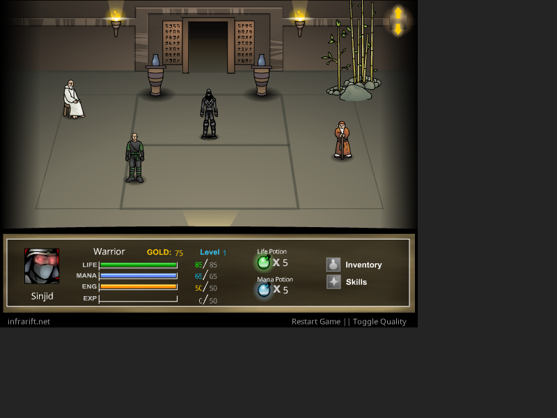
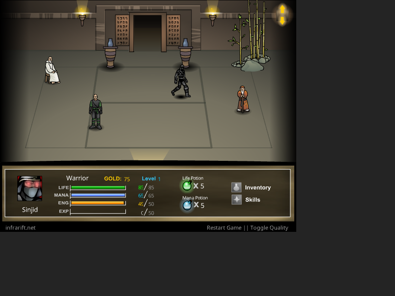
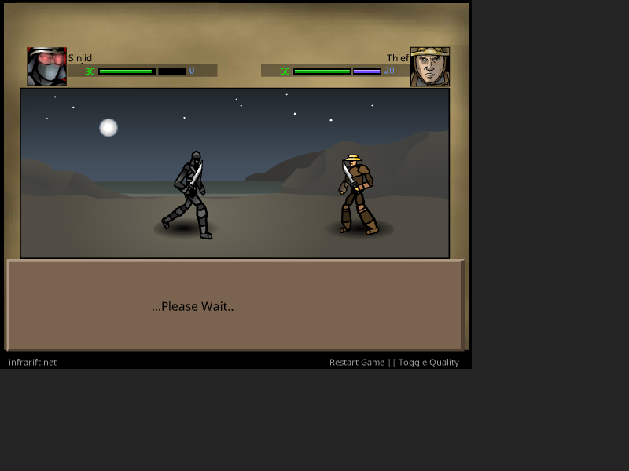
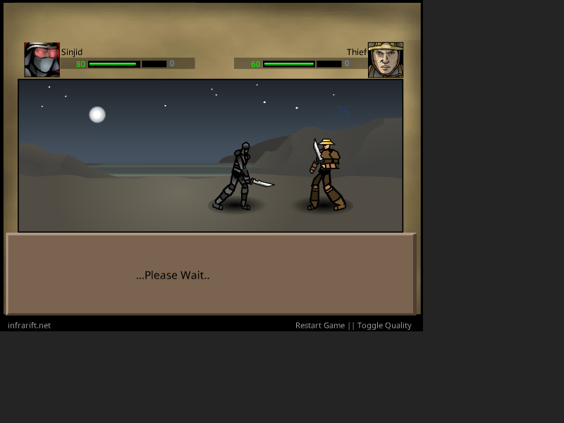

# ทบทวนภาพและความรู้สึก Sinjid เพื่อ Steampunk Warrior

วันที่ 28 ตุลาคม 2026 — ตรวจภาพและการเล่นต้นฉบับใหม่แล้วในขอบเขตการเดิน เข้าทางเชื่อม และโจมตีปกติ ยังไม่ครอบคลุมทุกสกิลและชุดอุปกรณ์

## ผลต่อเนื่อง: เปิดต้นฉบับสำเร็จและจับภาพเคลื่อนไหวใหม่

แก้ทางเปิดโดยใช้ Chrome for Testing ที่ติดตั้งอยู่กับ profile ทดสอบแยก พอร์ต 9338 แล้วให้ REA บันทึกการรันตัวควบคุม Playwright ไม่ใช้ probe.swf และไม่แก้สถานะผู้เล่นผ่านสคริปต์ ตัวโหลดเปิด original.swf เดิมด้วย Ruffle; จึงเป็นการเล่นผ่านตัวจำลอง ไม่ใช่ Flash Player ดั้งเดิม

- เริ่มเกมใหม่ เลือก Warrior จนถึงฐานพัก: `ev_aa075cfa24f597ff3d2af750c1d1520371e92be6d2b7f6cd075c897e2a2dac63`
- เดินและหยุด: `ev_90729834ccda5ba05eee194ca6d58815891f578f5afd2b1ba857753a288c0eab`
- เดินผ่านทางเชื่อมฐานพักไปห้องร้านค้า: `ev_21d89833e0ff365e4dbb1961c9392ac5b544b1ff71f18036f35aa42e63d6a7e0`
- เข้าห้อง Human Gateway: `ev_752263cfc13b03fd369f227867cacf7622464c2ad24c6196e8f6ad2efe3d2b9e`
- เปิดทางเข้าสู้ แสดง Human Gateway / Level 1: `ev_f3410c52582f9cb1f47b17773e14714c3ee071721dc4c25e7b98af7f031dafa3`
- โจมตีปกติ: `ev_d71ec03e57b356f2e8ef914b073a68d2dd16751fcec0bfa8027b280c7b405872`

ภาพและเวลา capture อยู่ใน `runtime/visual-2026-10-28/`. REA bundle ต่อเนื่องเก็บใน `rea-visual-resume-2026-10-28-evidence.json`. ตัวควบคุมอยู่ใน `visual-runtime.mjs`; input-manifest.json เป็นการรัน input ครั้งล่าสุดเท่านั้น ลำดับการรันก่อนหน้าคงอยู่ใน REA bundle และภาพที่ใช้ชื่อไม่ซ้ำ

### ข้อสังเกตจากภาพใหม่

1. การเดินเปลี่ยนรูปท่าจริง: ขางอและก้าวสลับ แขนเปลี่ยนมุม ตัวหันด้านข้าง เมื่อปล่อยปุ่มกลับท่ายืน ไม่ใช่การเลื่อนภาพนิ่ง
2. ฐานพักใช้ภาพด้านหน้าเฉียง เห็นพื้นลึกเข้าสู่ผนัง เงาสัมผัสใต้เท้า และของตกแต่งที่มีฐานวางบนพื้น แสงคบไฟเป็นจุดนำสายตา
3. ทางเข้าต้องเข้าใกล้แล้วกด Space. ไม่ใช่ชนแล้วเปลี่ยนฉากเองทุกจุด. เกมเราควรรักษาการเดินเข้าใกล้ปากท่อและกดปุ่มเข้า โดยแสดงคำใบ้ชัดเจน การก้าวเข้าและถูกขอบท่อบังเป็นการออกแบบเพิ่มของเรา
4. ก่อนสู้มีหน้าคั่นชื่อ Human Gateway / Level 1. เกมเราแปลงเป็นชื่อสายท่อและระดับแรงดัน/ระดับคู่ต่อสู้ โดยไม่ใช้หน้าคั่นนานเกินจำเป็น
5. โจมตีปกติมีระยะเดินเข้าหาคู่ต่อสู้จริง ก่อนยกอาวุธและฟัน. ภาพ attack-1, attack-3, attack-5, attack-8 แสดงท่าและตำแหน่งต่างกัน อาวุธอยู่ในมือ ตัวรับแรงเปลี่ยนท่า และมีเลขผลกระทบ
6. ระหว่างทำท่า แผงคำสั่งเปลี่ยนเป็น Please Wait จึงเห็นว่าผู้เล่นต้องรอการกระทำจบ. เกมเราใช้การแสดงว่าอยู่ระหว่างออกท่าที่ชัดเจน แต่คงตำแหน่งแถบสกิลเพื่อลดการกระโดดของ UI

ภาพถูกจับเป็นช่วงประมาณ 160–170 ms ระหว่างการเดิน แม้ตัวรอขอ 90 ms เพราะรวมเวลา screenshot. ไม่ใช้ช่วงเหล่านี้อ้างเฟรมเรตต้นฉบับหรือเวลามาตรฐานของท่า. ยังไม่ตรวจเสียงใหม่ ไม่ได้ลองทุกสกิล ไม่ได้ซื้อและสวมอุปกรณ์ทุกชิ้น และไม่ได้เล่นข้ามสายจนพิสูจน์สมดุลฟาร์มทั้งหมด

## ขอบเขตและหลักฐาน

ผู้ใช้ต้องการความรู้สึกใกล้ต้นฉบับ แต่เป็นโลกของเรา: เดินเข้าปากท่อแทนประตู เลือกเส้นทางต่อสู้สลับกันเพื่อฟาร์มได้ ตัวละครมีท่าทางและแสดงอุปกรณ์จริง

- หน้าอ้างอิง: https://www.webdesignmuseum.org/flash-games/sinjid-shadow-of-the-warrior-in-2004
- ไฟล์ต้นฉบับ `reference/sinjid/original.swf`, SHA256 `e258423f2a5887ff236a67eb6eaf674a8d573a5cdb721c20b79c831da4d9e008`.
- ตรวจภาพบันทึกเดิมด้วยตา: `runtime/screen_human_room.png`, `screen_enter_combat.png`, `screen_stab.png`, `screen_inventory.png`.
- ชื่อ `screen_start_hub.png` ไม่ตรงเนื้อหาจริง: ภาพเป็นหน้าเลือกอาชีพ จึงไม่นำชื่อไฟล์มาเป็นหลักฐานว่าถึงฐานพักแล้ว
- REA รอบนี้ตรวจ ActionScript ที่ถอดไว้ ผ่าน `capture_process_scenario`: `ev_036faf600aaa729446c558dae1e6adfd8e5ebc6e9011feb9616030a358c879b8`. ผลค้นและตำแหน่งอยู่ใน `visual-rea-static-2026-10-28.json`. เป็นหลักฐานโค้ด ไม่ใช่การวัดภาพเคลื่อนไหวขณะเล่น
- เบราว์เซอร์เก่าพอร์ต 9337 ไม่ทำงาน การเปิด Chrome ผ่าน REA หมดเวลาและรายงาน cleanup ของ browser_profile ไม่สมบูรณ์ ตรวจรายการ process แล้วไม่พบ process ที่มี playwright/remote-debugging/rea-browser; ยังไม่ยืนยันว่า profile ถูกลบ จึงไม่เปิดซ้ำ

## สิ่งที่เห็น และการแปลงเป็นเกมเรา

| ประเด็น | หลักฐานจากต้นฉบับ | แนวทางเกมเรา (ข้อเสนอออกแบบ) |
|---|---|---|
| ฐานพัก | ห้องมุมเฉียง เห็นพื้น ผนัง NPC และซุ้มทางเข้าขนาดใหญ่ ตัวละครยืนอยู่ในสถานที่จริง | สถานีสูบไอน้ำ มุมกล้องคงที่ มีพื้นเหล็ก ผนังโค้ง ปากท่อขนาดคนเดินเข้าได้ และ NPC ประจำพื้นที่ |
| องค์ประกอบภาพ | ภาพฐานพักใช้พื้นที่ฉากประมาณ 70% ของความสูงเกม แถบข้อมูลอยู่ด้านล่าง | ให้ฉากครองพื้นที่ประมาณ 70–75% เก็บข้อมูลจำเป็นในแถบล่าง ไม่วางแผงข้อความทับทางเดิน |
| จุดเข้า | ซุ้มกลางผนังมีกรอบ แสงด้านใน และพื้นต่อถึงปากทาง มองออกว่าเดินเข้าไปได้ | ปากท่อวงกลมมีขอบหนา พื้นลาดเชื่อมถึงทางเดิน แสงจากภายใน และวาล์วข้างท่อ ตัวละครเดินพ้นขอบแล้วถูกบังบางส่วนก่อนเปลี่ยนฉาก |
| สนามต่อสู้ | ฝ่ายผู้เล่นซ้าย ศัตรูขวา มีพื้นร่วมกัน เงาใต้เท้า และฉากไกลหลายระยะ | ลานซ่อม ท่อระบาย และเตาหลอมเป็นฉากต่อสู้เต็มพื้นที่ ตัวละครอยู่บนพื้นเดียวกัน ไม่อยู่ในกรอบการ์ด |
| ความชัดของตัวละคร | ภาพต่อสู้มีคนสูงประมาณ 100 พิกเซลในเกมกว้าง 600 พิกเซล เห็นอาวุธและท่ายืน | เริ่มทดลองสัดส่วนใกล้กัน แล้วทดสอบที่ 960/1280/1920 ให้เห็นแขนขาและอุปกรณ์โดยไม่ต้องซูม |
| รูปแบบภาพ | รูปร่างมีเส้นขอบชัด สีเป็นพื้นที่ เงาเรียบ ฉากไกลรายละเอียดต่ำกว่าตัวละคร | ภาพ 2D วาดเส้นชัด เหล็กดำ ทองเหลือง หนัง และผ้าคราม ใช้เขียวพิษกับศัตรูกลายพันธุ์ ความสมจริงมาจากน้ำหนัก สัดส่วน และแสง |
| คำสั่ง | แถบโจมตี ยา และช่องสกิลอยู่ด้านล่าง แถบชีวิตอยู่เหนือสนาม | ตำแหน่งคำสั่งคงที่ ไอคอนอ่านง่าย ตัวเลขค่าใช้สกิลและสถานะพร้อมใช้ชัดเจน |
| อุปกรณ์ | โค้ดเลือก sword/head/shield ตามข้อมูลผู้สวม และเปลี่ยนภาพชิ้นส่วนร่างกายตาม Suit | หัว ลำตัว แขน ขา มือ และจุดยึดอาวุธแยกกัน อุปกรณ์เปลี่ยนตามของที่ใส่ทั้งในฐานและสนามต่อสู้ |

สัดส่วนข้างต้นประเมินจากภาพเกม 600×470 โดยไม่รวมพื้นที่เบราว์เซอร์ด้านขวา ไม่ใช่ค่ากล้องที่วัดจาก runtime รอบใหม่

## หลักฐานด้านท่าทาง

`DefineSprite_907/frame_1/DoAction.as` เลือก Helmet และวน BodyParts เพื่อแสดง Suit. `DefineSprite_1836/frame_21/DoAction.as` เลือก swordtype, Helmet, shieldtype และ Suit ที่สัมพันธ์กับ subject. การเปลี่ยนอุปกรณ์จึงเป็นส่วนของตัวแสดงหลายชิ้น ไม่ใช่เพียงเปลี่ยน portrait ประจำอาชีพ

REA ค้นพบข้อความเลือกภาพดาบ 204 จุด หมวก 226 จุด และโล่ 254 จุดในไฟล์ ActionScript ที่ถอดไว้ ตัวเลขนี้คือจำนวนบรรทัดที่ตรงข้อความ ไม่ใช่จำนวนแอนิเมชันหรือจำนวนอุปกรณ์

พบ `movement.play()` ใน `DefineSprite_909/frame_1/PlaceObject2_908_2/CLIPACTIONRECORD onClipEvent(enterFrame)_2.as`. หลักฐานนี้สนับสนุนว่ามี timeline การเดิน แต่ยังไม่ให้จำนวนเฟรมหรือความเร็วท่าที่เห็นจริง ภาพ `screen_stab.png` เป็นภาพนิ่งหลังเลือกสกิล จึงไม่ใช้พิสูจน์จังหวะแทงหรือช่วงกระทบ

## วงจรปากท่อที่ต้องรักษา

ฐานพักเชื่อมปากท่อหลายสาย แต่ละสายจำความคืบหน้าศัตรูของตัวเอง แสดงชื่อสาย ระดับแนะนำ และคู่ต่อสู้ถัดไปเมื่อเข้าใกล้ ผู้เล่นเดินเข้าท่อเพื่อยืนยันการเข้าสนาม ไม่เปิดเมนูรายชื่อด่านเป็นวิธีหลัก

ตัวอย่างข้อเสนอ: ท่อระบายน้ำเป็นสายสัตว์กลายพันธุ์ ท่อขนส่งเป็นสายโจรและมนุษย์ ท่อแรงดันเป็นสายทหารโรงงานและศัตรูระดับสูง รูปร่างปากท่อ ป้ายสัญลักษณ์และสภาพแวดล้อมต้องบอกสายได้โดยไม่อาศัยสีอย่างเดียว

อย่างน้อยสองสายต้องเปิดให้เลือกก่อนบอสสายแรก ช่วงความยากต้องเหลื่อมกัน: ศัตรูต้นสายที่สองสู้ได้ก่อนชนะบอสสายแรก ไม่ใช่เปิดเส้นทางแล้วทุกตัวเก่งกว่าบอสที่ติดอยู่ การชนะให้รางวัลฟาร์มซ้ำและพัฒนาตัวละคร ความคืบหน้าสายอื่นไม่ถูกรีเซ็ตเมื่อสลับท่อ

นี่คือข้อกำหนดจากผู้ใช้และแบบสำหรับเกมเรา ยังไม่ได้ยืนยันลำดับปลดล็อกทุกประตูของต้นฉบับใหม่ในรอบนี้ และไม่ตีความว่าเป็นระบบยิงปืนเก่งขึ้นตามจำนวนครั้งที่ยิง

## ชุดการเคลื่อนไหวที่จะต้องทำ

- ยืน: น้ำหนักลงเท้า ขยับอกและแขนเล็กน้อย อุปกรณ์ตามจุดยึด
- เดิน: ขาสลับลงพื้น แขนแกว่ง ลำตัวถ่ายน้ำหนัก เท้าไม่ไถล ความเร็วท่าสัมพันธ์กับระยะเดิน
- เข้าท่อ: หันเข้าปากทาง ก้าวเข้า ถูกขอบท่อบัง แล้วเปลี่ยนฉาก มีเสียงโลหะและไอระบายสั้น ๆ
- โจมตี: เตรียมท่า ออกแรง กระทบ แล้วคืนท่า แขนและอาวุธเปลี่ยนมุมจริง
- ใช้สกิล: ท่าตามชนิด เช่น แทง ฟัน ปล่อยไอ หรือยิง อาวุธไม่หลุดมือ เอฟเฟกต์เริ่มจากจุดปล่อย
- รับการโจมตี/ป้องกัน/ล้ม: น้ำหนักและทิศทางชัด ไม่อาศัยกระพริบภาพทั้งชิ้นอย่างเดียว
- ตัวเลขความเสียหาย เสียง และผลกระทบแสดงตรงจังหวะสัมผัส การข้ามแอนิเมชันต้องไม่ทำให้คำนวณความเสียหายซ้ำ

ไม่กำหนดมิลลิวินาทีโดยอ้างว่ามาจากต้นฉบับจนกว่าจะบันทึกภาพเคลื่อนไหวใหม่ได้

## เกณฑ์ตรวจงานก่อนขยายทั้งเกม

1. ทำฐานพักหนึ่งฉากและท่อสองสายเป็นตัวอย่างเล่นจริง ใช้ระบบและเนื้อหาที่มีอยู่
2. ผู้เล่นติดบอสสายหนึ่ง เปลี่ยนไปสู้ต้นอีกสาย ได้ XP/เงิน พัฒนาของ แล้วกลับมาสู้ได้ เซฟความคืบหน้าทั้งสองสายครบ
3. ถ่ายวิดีโอเดิน ยืน เข้าท่อ และต่อสู้ให้เห็นแขนขาเปลี่ยนท่า ไม่ใช่แค่ภาพเลื่อน
4. เปลี่ยนอาวุธ โล่ หมวก และชุดแล้วเห็นผลทั้งสองฉาก ของไม่หลุดตำแหน่งเมื่อเดิน ฟัน รับแรง และกลับด้าน
5. ทางเข้าและตำแหน่งผู้เล่นตรงกับพื้นที่ชน เงาสัมผัสพื้น ขอบท่อบังตัวถูกลำดับ ไม่วาร์ปเพราะชนป้าย
6. ตรวจคีย์บอร์ดและคลิกจริง รวมโหลดเซฟเก่า การแพ้ การกลับฐาน และเข้าสายอื่น โดยรักษาการแก้บั๊กเปลี่ยนฉากใน 0.1.1

## สถานะ

องค์ประกอบภาพและการเดิน/เข้า Gateway/โจมตีปกติ: ตรวจการเล่นใหม่ผ่าน REA แล้วตามส่วนผลต่อเนื่องด้านบน. การประกอบอุปกรณ์: ตรวจโครงโค้ดผ่าน REA แล้ว แต่ยังไม่ลองสวมครบใน runtime. เสียง ทุกสกิล และเวลาท่าแบบละเอียด: ยังไม่ตรวจครบ. ข้อเสนอปากท่อและเกณฑ์รับงาน: พร้อมนำไปปรับแบบ. ยังไม่ได้เปลี่ยนเกมหรือออก build ใหม่ในรอบนี้
