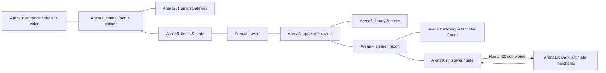

# Sinjid world, encounter and narrative reconstruction (static)

Date: 2026-10-27. Target: preserved Archive SWF `sinjid-shadow-of-the-316817f.swf`, SHA-256 `e258423f2a5887ff236a67eb6eaf674a8d573a5cdb721c20b79c831da4d9e008`.

This is a static reconstruction from the complete FFdec 26.4.0 ActionScript/text export plus direct SWF FrameLabel parsing. It does not establish that gameplay was observed through REA. Parent investigation owns REA execution Evidence and runtime checks. Decompiled AS2 is a reconstruction, not original source formatting. Numbers below are exact visible assignments/guards in this preserved build, with execution-dependent behavior called out separately.

Machine-readable inventory: [sinjid-world-inventory.json](/Users/Projects/Steampunk-warrior/docs/research/sinjid-world-inventory.json). It retains all top-level labels, each room's explicit blocked cells, exit handlers/NPC instances, and all 40 encounter-label assignment dictionaries. Census assertions verified 11 rooms, 20 Human, 10 Monster, 5 Dark and 3 Training definitions, plus 2 extra WASP labels.

## Results that supersede the preliminary small-game proposal

- 11 actual hub room FrameLabels (`Arena0` through `Arena10`), not 1 hub screen or a verified 12 rooms.
- 35 gateway encounters: Human 20, Monster 10, Dark 5. Three separate training tiers. Two additional WASP encounter definitions exist but no incoming literal references were found in the exported ActionScript; do not count them as proven accessible missions.
- 9 gateway fights contain two enemies: Human 4/7/10/11/19/20 and Monster 5/7/8. The original is not limited to 1v1.
- 24 gateway enemy archetypes including Poison Wasp and all five Dark bosses; Training Ward is a 25th archetype. `Mecenary` is the actual suit key for Mercenary. Distinct stage configurations vary stats even when archetype repeats.
- 34 placed NPC-role instances in hub scripts, including service NPCs, informants and statues. This is not 34 unique named characters.
- Two implemented side activity chains (herb conversion and moon-ring skill point), four informational library texts, explicit hunger/energy attrition, limited full-rest uses, paid services and manual saving.
- One main-story exit condition: finish Human20; Monster/Dark are optional. One ending text was identified, not branching endings.

## Level design: topology, rooms, gates and space

The hub uses a 20-column × 11-row collision grid, 30 pixels per cell; blocked cells are type 2 and traversable cells type 1. The move controller tests the next cell using a character radius. Arrow keys/WASD move; Space interacts with portals/NPCs/exits. Runtime collision corner behavior and visual readability still need play testing. Source: [scripts/frame_20/DoAction_2.as](</Users/Projects/Steampunk-warrior/reference/sinjid/decompiled/scripts/frame_20/DoAction_2.as:21>), [scripts/frame_20/DoAction_2.as](</Users/Projects/Steampunk-warrior/reference/sinjid/decompiled/scripts/frame_20/DoAction_2.as:117>).

| Actual FrameLabel / frame | Function and occupants | Explicit obstacle cells | Exit FrameLabels |
| --- | --- | ---: | --- |
| Arena0 / 21 | Entrance: elder/save, healer, student; final exit | 27 | Arena1 |
| Arena1 / 22 | Central junction: food/potion vendors, navigation informant | 43 | Arena0, Arena2, Arena3 |
| Arena2 / 23 | Human portal: apprentice, training hint guard | 31 | Arena1 |
| Arena3 / 24 | Basic item vendor, busy trader, apprentice | 31 | Arena4, Arena1 |
| Arena4 / 25 | Tavern: 3 drinkers and ninja | 33 | Arena3, Arena5 |
| Arena5 / 26 | Upper equipment vendors and strength/equipment warning | 29 | Arena7, Arena6, Arena4 |
| Arena6 / 27 | Library: scribe, Lady herb converter, relaxing ninja | 45 | Arena5 |
| Arena7 / 28 | Shrine: statues and moon-ring interaction | 30 | Arena5, Arena9, Arena8 |
| Arena8 / 29 | Training note/selector, Monster portal, late equipment vendor, guards | 35 | Arena7 |
| Arena9 / 30 | Dark entrance gate, meditating ring-giver and guard | 28 | Arena10, Arena7 |
| Arena10 / 31 | Dark Rift, two late merchants and tactical informants | 31 | Arena9 |

Room geometry sources are `scripts/frame_21/DoAction.as` through `frame_31/DoAction.as`. Exact exit targets are attached `CLIPACTIONRECORD onClipEvent(load).as` scripts recorded in the JSON inventory; the shared exit sprite calls `gotoAndStop(stagelabel)` after its transition: [scripts/DefineSprite_1504/frame_12/DoAction.as](</Users/Projects/Steampunk-warrior/reference/sinjid/decompiled/scripts/DefineSprite_1504/frame_12/DoAction.as:1>), [scripts/DefineSprite_1602/frame_4/DoAction.as](</Users/Projects/Steampunk-warrior/reference/sinjid/decompiled/scripts/DefineSprite_1602/frame_4/DoAction.as:1>).

A source trap: frames 25–28 assign `_root.currentstage = "Arena0"`, although their actual binary FrameLabels are Arena4–7. Therefore a map derived only from `currentstage` would collapse four rooms and misreport combat-return locations. The topology above uses real FrameLabels plus exit `stagelabel` targets. `EnemyMeet` saves currentstage/current coordinates, so whether the wrong string produces a visible return bug needs runtime confirmation: [scripts/frame_17/DoAction.as](</Users/Projects/Steampunk-warrior/reference/sinjid/decompiled/scripts/frame_17/DoAction.as:274>).

The overall design is a branching service hub rather than 35 fully walkable combat levels. Gateway backgrounds are picked randomly from Snow, Coast, Grass and Desert. Thus room count, encounter count, enemy archetype count and visual backdrop count must remain separate metrics. Source: [scripts/frame_17/DoAction_3.as](</Users/Projects/Steampunk-warrior/reference/sinjid/decompiled/scripts/frame_17/DoAction_3.as:14>), [scripts/frame_23/PlaceObject2_1504_163/CLIPACTIONRECORD onClipEvent(keyDown).as](</Users/Projects/Steampunk-warrior/reference/sinjid/decompiled/scripts/frame_23/PlaceObject2_1504_163/CLIPACTIONRECORD onClipEvent(keyDown).as:7>).

Human entry accepts levels <=20 and increments the portal counter at entry; Monster uses <=10; Dark uses <=5. The arrays themselves initialize 20 strings each, but the entry guards and actual FrameLabels determine reachable gateway counts. This resolves the review claiming 20 Monster fights: there are only ten defined reachable Monster stages here. Human completion (`portallevel[0] > 20`) gates both the final exit and access to Arena10. Monster and Dark do not gate the story ending. Sources: [scripts/frame_23/PlaceObject2_1504_163/CLIPACTIONRECORD onClipEvent(keyDown).as](</Users/Projects/Steampunk-warrior/reference/sinjid/decompiled/scripts/frame_23/PlaceObject2_1504_163/CLIPACTIONRECORD onClipEvent(keyDown).as:7>), [scripts/frame_29/PlaceObject2_1504_59/CLIPACTIONRECORD onClipEvent(keyDown).as](</Users/Projects/Steampunk-warrior/reference/sinjid/decompiled/scripts/frame_29/PlaceObject2_1504_59/CLIPACTIONRECORD onClipEvent(keyDown).as:7>), [scripts/frame_31/PlaceObject2_1504_10/CLIPACTIONRECORD onClipEvent(keyDown).as](</Users/Projects/Steampunk-warrior/reference/sinjid/decompiled/scripts/frame_31/PlaceObject2_1504_10/CLIPACTIONRECORD onClipEvent(keyDown).as:6>), [scripts/frame_30/PlaceObject2_1504_59/CLIPACTIONRECORD onClipEvent(keyDown).as](</Users/Projects/Steampunk-warrior/reference/sinjid/decompiled/scripts/frame_30/PlaceObject2_1504_59/CLIPACTIONRECORD onClipEvent(keyDown).as:4>), [scripts/frame_21/PlaceObject2_1504_259/CLIPACTIONRECORD onClipEvent(keyDown).as](</Users/Projects/Steampunk-warrior/reference/sinjid/decompiled/scripts/frame_21/PlaceObject2_1504_259/CLIPACTIONRECORD onClipEvent(keyDown).as:4>).

## Complete gateway encounter progression

HP, speed, EXP, gold and energy below are configured values. These are starting stats/reward parameters, not observed post-battle payouts. Extra damage/defense/shield fields remain in the JSON for every encounter. Stages link to the full definition.

| Stage / definition | Enemy 1 + optional enemy 2 | HP 1 / HP 2 | Speed 1 / 2 | EXP | Gold | Energy cost |
| --- | --- | --- | --- | ---: | ---: | ---: |
| [HUMAN1](</Users/Projects/Steampunk-warrior/reference/sinjid/decompiled/scripts/frame_49/DoAction.as:1>) | Thief | 60 / 0 | 15 / — | 30 | 30 | 10 |
| [HUMAN2](</Users/Projects/Steampunk-warrior/reference/sinjid/decompiled/scripts/frame_50/DoAction.as:1>) | Bandit | 40 / 0 | 15 / — | 30 | 40 | 10 |
| [HUMAN3](</Users/Projects/Steampunk-warrior/reference/sinjid/decompiled/scripts/frame_51/DoAction.as:1>) | Raider | 120 / 0 | 15 / — | 40 | 50 | 10 |
| [HUMAN4](</Users/Projects/Steampunk-warrior/reference/sinjid/decompiled/scripts/frame_35/DoAction.as:1>) | Bandit + Thief | 100 / 140 | 15 / 15 | 60 | 100 | 20 |
| [HUMAN5](</Users/Projects/Steampunk-warrior/reference/sinjid/decompiled/scripts/frame_52/DoAction.as:1>) | Warrior | 180 / 0 | 15 / — | 40 | 60 | 15 |
| [HUMAN6](</Users/Projects/Steampunk-warrior/reference/sinjid/decompiled/scripts/frame_53/DoAction.as:1>) | Seer | 200 / 0 | 17 / — | 40 | 70 | 15 |
| [HUMAN7](</Users/Projects/Steampunk-warrior/reference/sinjid/decompiled/scripts/frame_36/DoAction.as:1>) | Raider + Warrior | 200 / 230 | 15 / 15 | 80 | 130 | 30 |
| [HUMAN8](</Users/Projects/Steampunk-warrior/reference/sinjid/decompiled/scripts/frame_54/DoAction.as:1>) | Mecenary | 400 / 0 | 14 / — | 60 | 80 | 15 |
| [HUMAN9](</Users/Projects/Steampunk-warrior/reference/sinjid/decompiled/scripts/frame_55/DoAction.as:1>) | Assailant | 100 / 0 | 50 / — | 60 | 90 | 15 |
| [HUMAN10](</Users/Projects/Steampunk-warrior/reference/sinjid/decompiled/scripts/frame_37/DoAction.as:1>) | Seer + Warrior | 260 / 280 | 17 / 14 | 100 | 220 | 30 |
| [HUMAN11](</Users/Projects/Steampunk-warrior/reference/sinjid/decompiled/scripts/frame_38/DoAction.as:1>) | Mecenary + Assailant | 420 / 110 | 10 / 50 | 150 | 260 | 30 |
| [HUMAN12](</Users/Projects/Steampunk-warrior/reference/sinjid/decompiled/scripts/frame_56/DoAction.as:1>) | Agent | 550 / 0 | 19 / — | 150 | 160 | 20 |
| [HUMAN13](</Users/Projects/Steampunk-warrior/reference/sinjid/decompiled/scripts/frame_57/DoAction.as:1>) | Seer | 600 / 0 | 19 / — | 150 | 120 | 20 |
| [HUMAN14](</Users/Projects/Steampunk-warrior/reference/sinjid/decompiled/scripts/frame_58/DoAction.as:1>) | Shaman | 700 / 0 | 19 / — | 200 | 70 | 20 |
| [HUMAN15](</Users/Projects/Steampunk-warrior/reference/sinjid/decompiled/scripts/frame_59/DoAction.as:1>) | Assailant | 180 / 0 | 60 / — | 120 | 120 | 25 |
| [HUMAN16](</Users/Projects/Steampunk-warrior/reference/sinjid/decompiled/scripts/frame_60/DoAction.as:1>) | Ronin | 900 / 0 | 19 / — | 120 | 120 | 25 |
| [HUMAN17](</Users/Projects/Steampunk-warrior/reference/sinjid/decompiled/scripts/frame_61/DoAction.as:1>) | Agent | 1000 / 0 | 21 / — | 120 | 140 | 25 |
| [HUMAN18](</Users/Projects/Steampunk-warrior/reference/sinjid/decompiled/scripts/frame_62/DoAction.as:1>) | Samurai | 1100 / 0 | 18 / — | 160 | 230 | 25 |
| [HUMAN19](</Users/Projects/Steampunk-warrior/reference/sinjid/decompiled/scripts/frame_39/DoAction.as:1>) | Ronin + Shaman | 1000 / 1000 | 20 / 20 | 500 | 320 | 35 |
| [HUMAN20](</Users/Projects/Steampunk-warrior/reference/sinjid/decompiled/scripts/frame_40/DoAction.as:1>) | Samurai + Samurai | 1350 / 1350 | 17 / 17 | 550 | 750 | 35 |
| [MONSTER1](</Users/Projects/Steampunk-warrior/reference/sinjid/decompiled/scripts/frame_64/DoAction.as:1>) | Poison Wasp | 550 / 0 | 35 / — | 170 | 250 | 30 |
| [MONSTER2](</Users/Projects/Steampunk-warrior/reference/sinjid/decompiled/scripts/frame_65/DoAction.as:1>) | Zombie | 1200 / 0 | 15 / — | 180 | 225 | 30 |
| [MONSTER3](</Users/Projects/Steampunk-warrior/reference/sinjid/decompiled/scripts/frame_66/DoAction.as:1>) | Skeleton Mage | 400 / 0 | 22 / — | 200 | 260 | 30 |
| [MONSTER4](</Users/Projects/Steampunk-warrior/reference/sinjid/decompiled/scripts/frame_67/DoAction.as:1>) | Mountain Naga | 1100 / 0 | 22 / — | 200 | 265 | 30 |
| [MONSTER5](</Users/Projects/Steampunk-warrior/reference/sinjid/decompiled/scripts/frame_41/DoAction.as:1>) | Skeleton + Zombie | 400 / 1500 | 25 / 17 | 300 | 450 | 45 |
| [MONSTER6](</Users/Projects/Steampunk-warrior/reference/sinjid/decompiled/scripts/frame_68/DoAction.as:1>) | Golem | 700 / 0 | 20 / — | 200 | 270 | 35 |
| [MONSTER7](</Users/Projects/Steampunk-warrior/reference/sinjid/decompiled/scripts/frame_42/DoAction.as:1>) | Skeleton Mage + Skeleton | 500 / 450 | 27 / 27 | 350 | 450 | 50 |
| [MONSTER8](</Users/Projects/Steampunk-warrior/reference/sinjid/decompiled/scripts/frame_43/DoAction.as:1>) | Golem + Mountain Naga | 1000 / 1150 | 27 / 27 | 350 | 460 | 35 |
| [MONSTER9](</Users/Projects/Steampunk-warrior/reference/sinjid/decompiled/scripts/frame_69/DoAction.as:1>) | Semi Demon | 2300 / 0 | 25 / — | 300 | 300 | 40 |
| [MONSTER10](</Users/Projects/Steampunk-warrior/reference/sinjid/decompiled/scripts/frame_70/DoAction.as:1>) | Flesh Fiend | 2350 / 0 | 30 / — | 500 | 500 | 40 |
| [DARK1](</Users/Projects/Steampunk-warrior/reference/sinjid/decompiled/scripts/frame_72/DoAction.as:1>) | Liquid Metal | 3000 / 0 | 27 / — | 300 | 300 | 50 |
| [DARK2](</Users/Projects/Steampunk-warrior/reference/sinjid/decompiled/scripts/frame_73/DoAction.as:1>) | Blood Spirit | 1800 / 0 | 35 / — | 400 | 300 | 55 |
| [DARK3](</Users/Projects/Steampunk-warrior/reference/sinjid/decompiled/scripts/frame_74/DoAction.as:1>) | Fallen Guardian | 4000 / 0 | 38 / — | 500 | 400 | 70 |
| [DARK4](</Users/Projects/Steampunk-warrior/reference/sinjid/decompiled/scripts/frame_75/DoAction.as:1>) | Fallen Ninja | 4000 / 0 | 80 / — | 600 | 500 | 80 |
| [DARK5](</Users/Projects/Steampunk-warrior/reference/sinjid/decompiled/scripts/frame_76/DoAction.as:1>) | Shadow Reaper | 1000 / 0 | 60 / — | 700 | 600 | 80 |

The progression is not a simple increasing-HP ladder. Human9/15 Assailants trade low HP for speed 50/60; dual stages combine roles. Dark1 Liquid Metal uses 70% physical defense, Dark2 Blood Spirit uses 4000 shield points and magic-only base damage, Dark4 Fallen Ninja speed 80, Dark5 Shadow Reaper only 1000 HP but 85% physical and magical defense. These encourage preparation and changing tactics, not only leveling. Full enemy move logic is covered by the companion combat analysis; the configured traits are visible in the linked stage files above.

## Training and repeatability

Training is a separate manual selection available from Arena8, requiring positive energy. Basic: EXP rate 3, energy 2; intermediate: EXP rate 5, energy 3; advanced: EXP rate 20, energy 10. Sources: [scripts/DefineButton2_1453/BUTTONCONDACTION on(release).as](</Users/Projects/Steampunk-warrior/reference/sinjid/decompiled/scripts/DefineButton2_1453/BUTTONCONDACTION on(release).as:2>), [scripts/DefineButton2_1454/BUTTONCONDACTION on(release).as](</Users/Projects/Steampunk-warrior/reference/sinjid/decompiled/scripts/DefineButton2_1454/BUTTONCONDACTION on(release).as:2>), [scripts/DefineButton2_1455/BUTTONCONDACTION on(release).as](</Users/Projects/Steampunk-warrior/reference/sinjid/decompiled/scripts/DefineButton2_1455/BUTTONCONDACTION on(release).as:2>).

| Tier | Ward HP | Shield | Speed | Base physical/magic damage |
| --- | ---: | ---: | ---: | --- |
| TRAIN1 / Basic | 80 | 300 | 15 | 5 / 5 |
| TRAIN2 / Intermediate | 180 | 500 | 30 | 8 / 8 |
| TRAIN3 / Advanced | 300 | 700 | 40 | 12 / 12 |

The rates are applied by Training Ward reaction animations, not the visual damage counter: a shielded non-breaking hit enters block/child2115 and adds exprate while deducting engrate; the breaking blow enters blockbreak/child2120 and awards no XP or energy cost; an unshielded body hit enters hit/child2107 and adds ceil(exprate×2) while deducting engrate. A killing blow may replace the hit reaction with die before its frame3 award, so it must not be assumed to earn the body-hit award. Reaching zero energy sets endtrain. A manual End Training button sets the same flag. Combat completion accepts endtrain as a victory/settlement path, preserving earned EXP; normal gateway repeat behavior does not automatically imply training behavior. Sources: [scripts/DefineSprite_2115/frame_3/DoAction.as](</Users/Projects/Steampunk-warrior/reference/sinjid/decompiled/scripts/DefineSprite_2115/frame_3/DoAction.as:1>), [scripts/DefineSprite_2107/frame_3/DoAction.as](</Users/Projects/Steampunk-warrior/reference/sinjid/decompiled/scripts/DefineSprite_2107/frame_3/DoAction.as:1>), [scripts/DefineButton2_2132/BUTTONCONDACTION on(release).as](</Users/Projects/Steampunk-warrior/reference/sinjid/decompiled/scripts/DefineButton2_2132/BUTTONCONDACTION on(release).as:1>), [scripts/DefineSprite_1993/frame_14/DoAction.as](</Users/Projects/Steampunk-warrior/reference/sinjid/decompiled/scripts/DefineSprite_1993/frame_14/DoAction.as:13>).

Portal counters advance before the fight and decrement on the retry-from-defeat action. After successful completion there is no visible stage selector for replaying earlier gateway stages. Training is the explicit renewable progression path. Do not assume the new design's replayable mission list existed in Sinjid. Source: [scripts/DefineButton2_2250/BUTTONCONDACTION on(release).as](</Users/Projects/Steampunk-warrior/reference/sinjid/decompiled/scripts/DefineButton2_2250/BUTTONCONDACTION on(release).as:1>).

## Energy, loss, recovery and saving

Initial energy is 50 and initial limited-rest count 10. In the overworld, positive energy sets movement speed 6; zero sets it to 4. The walking-menu timeline periodically decrements energy and, when empty, reduces HP/MP while respecting a floor. The frame240 block only decrements mana when life >1 as well, so do not summarize this as an independent unconditional MP drain. Other timeline blocks also decrement at zero energy; frame frequency cannot be translated to wall-clock seconds without verifying the movie playback path. Sources: [scripts/frame_17/DoAction_3.as](</Users/Projects/Steampunk-warrior/reference/sinjid/decompiled/scripts/frame_17/DoAction_3.as:13>), [scripts/frame_17/DoAction_3.as](</Users/Projects/Steampunk-warrior/reference/sinjid/decompiled/scripts/frame_17/DoAction_3.as:79>), [scripts/frame_20/DoAction_2.as](</Users/Projects/Steampunk-warrior/reference/sinjid/decompiled/scripts/frame_20/DoAction_2.as:124>), [scripts/DefineSprite_622/frame_240/DoAction.as](</Users/Projects/Steampunk-warrior/reference/sinjid/decompiled/scripts/DefineSprite_622/frame_240/DoAction.as:1>), [scripts/DefineSprite_622/frame_12/DoAction.as](</Users/Projects/Steampunk-warrior/reference/sinjid/decompiled/scripts/DefineSprite_622/frame_12/DoAction.as:1>).

Victory's continue action deducts the encounter's energy cost, clamps energy at zero, persists hero1 HP/MP to overworld values and reloads the hub. Defeat's retry/return action decrements the last portal index and restores only 5 HP, 5 MP and 5 energy. This differs substantially from free full healing. Sources: [scripts/DefineButton2_2170/BUTTONCONDACTION on(release, keyPress Space).as](</Users/Projects/Steampunk-warrior/reference/sinjid/decompiled/scripts/DefineButton2_2170/BUTTONCONDACTION on(release, keyPress Space).as:1>), [scripts/DefineButton2_2250/BUTTONCONDACTION on(release).as](</Users/Projects/Steampunk-warrior/reference/sinjid/decompiled/scripts/DefineButton2_2250/BUTTONCONDACTION on(release).as:1>).

Elder full-rest action requires rests>0, decrements one rest and fully restores HP/MP/energy. The entrance also places a separate healer service; service pricing belongs to the companion economy inventory. Source: [scripts/DefineButton2_1333/BUTTONCONDACTION on(release).as](</Users/Projects/Steampunk-warrior/reference/sinjid/decompiled/scripts/DefineButton2_1333/BUTTONCONDACTION on(release).as:1>).

Manual save uses Flash SharedObject `user_profile`, saving base stats, level/XP/XP threshold, gold, equipment names, potion counts, skill points, all skill ranks, item slots, class, portrait, remaining rests, portal counters and current HP/MP/energy, then flushes. It does not save current room or XY position in that list. Two save/load variants exist: elder/save and initial load include moon_q, while an end-screen save/reload pair omits it. A source-level inconsistency is visible, but an actual duplication bug requires runtime validation. Sources: [scripts/frame_17/DoAction_3.as](</Users/Projects/Steampunk-warrior/reference/sinjid/decompiled/scripts/frame_17/DoAction_3.as:9>), [scripts/DefineButton2_1332/BUTTONCONDACTION on(release).as](</Users/Projects/Steampunk-warrior/reference/sinjid/decompiled/scripts/DefineButton2_1332/BUTTONCONDACTION on(release).as:1>), [scripts/DefineButton2_467/BUTTONCONDACTION on(release).as](</Users/Projects/Steampunk-warrior/reference/sinjid/decompiled/scripts/DefineButton2_467/BUTTONCONDACTION on(release).as:1>), [scripts/DefineButton2_2254/BUTTONCONDACTION on(release).as](</Users/Projects/Steampunk-warrior/reference/sinjid/decompiled/scripts/DefineButton2_2254/BUTTONCONDACTION on(release).as:1>), [scripts/DefineButton2_2257/BUTTONCONDACTION on(release).as](</Users/Projects/Steampunk-warrior/reference/sinjid/decompiled/scripts/DefineButton2_2257/BUTTONCONDACTION on(release).as:1>).

## Narrative, dialogue, knowledge and side activities

Opening narrative: Lord Baka destroys a village; Hattori entrusts young Sinjid to Fujin. Fujin raises/trains Sinjid in the mountains for twenty years and brings him to the Shadow Temple to kill the Human Gateway opponents as final training. This main premise is text-driven, separate from the combat portals. Sources: [texts/106.txt](</Users/Projects/Steampunk-warrior/reference/sinjid/decompiled/texts/106.txt:1>), [texts/484.txt](</Users/Projects/Steampunk-warrior/reference/sinjid/decompiled/texts/484.txt:1>).

Ending: after leaving the arena, Sinjid finds Fujin gone and a letter directing him to defend the highlands from the regrouped Fallen Army and seek a meeting at the mountain peak. This is a sequel hook, not the defeat of Lord Baka in an identified encounter; HUMAN20 is two Samurai. Source: [texts/2262.txt](</Users/Projects/Steampunk-warrior/reference/sinjid/decompiled/texts/2262.txt:1>).

Dialogue is proximity + Space, fills TalkBox SpeakerText/TalkText, pauses gameplay and starts its display animation. Most NPCs are a fixed one-message hint/service; the herb Lady and meditating ninja branch on item/quest state. There is no evidence here of a general branching conversation-choice tree. Complete placed-role and load-dialogue strings are indexed in JSON, preserving each source.

Library has four preserved texts: general strategy/classes/attributes and inventory-space warnings (`1375`), Dark Rift enemy intelligence (`1377`), Mendo's ring riddle (`1379`) and Shadow Wolves lore (`1381`). This makes knowledge acquisition part of preparation even though the room contains no combat. Do not count lore-only Shadow Wolves as an actual encounter archetype. Sources: [texts/1375.txt](</Users/Projects/Steampunk-warrior/reference/sinjid/decompiled/texts/1375.txt:1>), [texts/1377.txt](</Users/Projects/Steampunk-warrior/reference/sinjid/decompiled/texts/1377.txt:1>), [texts/1379.txt](</Users/Projects/Steampunk-warrior/reference/sinjid/decompiled/texts/1379.txt:1>), [texts/1381.txt](</Users/Projects/Steampunk-warrior/reference/sinjid/decompiled/texts/1381.txt:1>).

Herb chain: Lady in Arena6 repeatedly searches/consumes White Leaves and produces Medicine, up to eight searches per interaction. This is repeatable item conversion, not a one-time quest with a dedicated completion flag. Her response changes when conversion succeeds. Source: [scripts/frame_27/PlaceObject2_1542_123/CLIPACTIONRECORD onClipEvent(keyDown).as](</Users/Projects/Steampunk-warrior/reference/sinjid/decompiled/scripts/frame_27/PlaceObject2_1542_123/CLIPACTIONRECORD onClipEvent(keyDown).as:6>). Medicine acquisition/sale pricing is catalogued with items/economy.

Moon-ring chain: meditating ninja in Arena9 gives Mendo's Ring once if moon_q is false and inventory has space, then sets moon_q; full inventory changes response without completing the gift. At the moon object in Arena7, consuming the ring awards one extra skill point. The library riddle supplies the clue. Sources: [scripts/frame_30/PlaceObject2_1542_81/CLIPACTIONRECORD onClipEvent(keyDown).as](</Users/Projects/Steampunk-warrior/reference/sinjid/decompiled/scripts/frame_30/PlaceObject2_1542_81/CLIPACTIONRECORD onClipEvent(keyDown).as:6>), [scripts/frame_28/PlaceObject2_1702_151/CLIPACTIONRECORD onClipEvent(keyDown).as](</Users/Projects/Steampunk-warrior/reference/sinjid/decompiled/scripts/frame_28/PlaceObject2_1702_151/CLIPACTIONRECORD onClipEvent(keyDown).as:4>).

The `newobjective` field is serialized and an Objectives display text exists, but a bounded search of all exported scripts found no assignment that demonstrates a multi-quest journal. Do not turn that field name alone into a claim of a full quest-log system.

## Coverage / remaining uncertainty

| Area | Static coverage | Runtime gap |
| --- | --- | --- |
| Rooms/topology | All 11 FrameLabels, exits and explicit blocked cells indexed | Actual visual placement/transforms, collision corners and return-position bug not observed |
| Gateway progression | All 35 stage definitions and entry guards, 9 dual fights | All fights have not been played; enemy action timing delegated to combat analysis |
| Training | All 3 tier parameters, shield/body/break reaction callbacks and end flag | Exact animation cadence, end-of-training payout and edge cases not exercised |
| Story/side activities | Opening, ending, all placed role/load-dialogue assignments; both item chains | No playthrough of gift/consumption/save/reload branches |
| Save/loss/recovery | All relevant identified save/load/retry/restore handlers | Browser persistence and corruption behavior not exercised |
| Extra content | WASP/WASP2 and lore-only wolves distinguished from reachable missions | No incoming literal reference found does not prove an unused label can never be reached indirectly |

This world reconstruction is comprehensive for exported static room/progression records, not a claim that REA runtime analysis or the entire game investigation is complete. A new game that must exceed Sinjid should be measured against these categories separately: at least exceed 11 meaningful hub/exploration rooms, 35 authored battle configurations, 24 normal enemy archetypes, multiple-enemy tactics, 3 training tiers, and the original's preparation/knowledge/side-activity roles. More rows alone are not more depth; distinct encounter roles, route decisions, readable enemy mechanics and meaningful build alternatives must be verified in play.

## Runtime corroboration — 2026-10-27

This report records static reconstruction. Subsequent representative runtime results, including their controlled fixtures, exact REA Evidence IDs and unresolved limits, are summarized in [runtime coverage](runtime-coverage.md). Earlier statements that runtime was pending describe this report’s original inspection time; they are not the final project coverage status. No exhaustive playthrough is implied.
